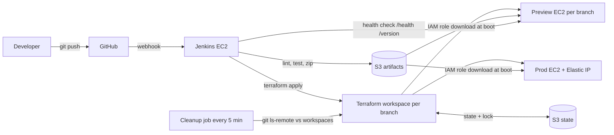

# PushPad

A self-hosted mini Vercel for a DevOps course project. **Every Git branch gets its own temporary AWS EC2 environment with a live URL**, created by Terraform and triggered by Jenkins. Deleting or merging the branch destroys it. `main` deploys to production behind an approval gate, with automatic rollback.

Tools: Git/GitHub, Jenkins, Terraform, AWS. No Docker, Kubernetes or Ansible. Region: ap-south-1.

## Architecture



## What each tool does
| Tool | Role |
|---|---|
| Git / GitHub | Source of truth. A branch is a request for an environment. |
| Jenkins | Runs the pipeline: test, package, deploy, health check, notify, cleanup. |
| Terraform | Creates the EC2, security group, IAM role (and Elastic IP for prod). One workspace per branch. |
| AWS | EC2 runs the app, S3 stores build zips and Terraform state, IAM gives servers read-only access to zips. |

## Pipeline stages (`Jenkinsfile`)
| # | Stage | What happens |
|---|---|---|
| 1 | Checkout | Get code; map branch to workspace (`scripts/workspace-name.sh`). |
| 2 | Install and Lint | `npm ci`, ESLint. |
| 3 | Test | Jest; publishes JUnit results. A bad `menu.json` fails here. |
| 4 | Package | Write `version.json`, production deps only, zip `app/`. |
| 5 | Upload to S3 | Zip goes to the artifacts bucket. |
| 6 | Terraform Init | Remote state, select or create the branch workspace. |
| 7 | Approval | Only on `main`: "Deploy build N to PROD?" |
| 8 | Terraform Apply | New EC2 boots from the zip; prod rollback target saved first. |
| 9 | Health Check | Retry `/health` up to 3 min, `/version` must show this build; on prod failure, roll back. |
| 10 | Notify | Print URL, set build description, optional Telegram. |

`Jenkinsfile.cleanup` runs every 5 minutes: destroys workspaces whose branch no longer exists (via `git ls-remote --heads`) and previews older than 24 h, then deletes their zips.

## Repo layout
```
app/              Express app + static frontend (app/public) + tests
infra/            Terraform for one environment (+ bootstrap/ for the buckets)
scripts/          workspace-name, aws-env, health-check, cleanup, bootstrap-jenkins, destroy-all
Jenkinsfile       branch pipeline          Jenkinsfile.cleanup   cleanup cron job
docs/             SETUP.md (do first), DEMO.md (live demo script)
```

Run locally: `cd app && npm ci && npm start` then open http://localhost:3000.
