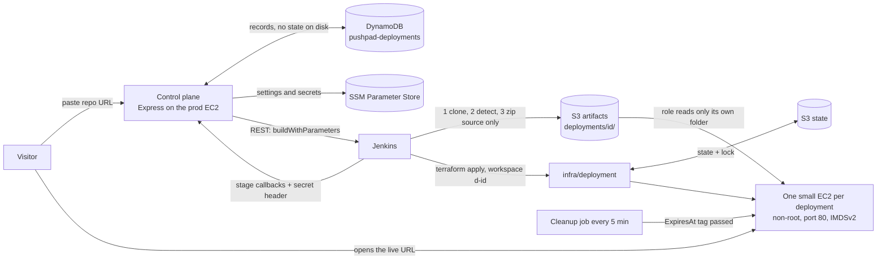

# PushPad

**Share your code as a live site in 2 minutes. No setup, no env vars.**

Paste a public GitHub repo, click Deploy, watch the pipeline run, and get a link that works for 30 minutes. Then the server is deleted. Think Vercel preview deployments, self-hosted on your own AWS with Jenkins and Terraform.

Tools: Git/GitHub, Jenkins, Terraform, AWS. No Docker, Kubernetes or Ansible. Region: ap-south-1.

PushPad does two jobs with the same pipeline ideas:

| Mode | What it does | Entry point |
|---|---|---|
| **Quick Share** (the product) | Deploys any visitor's public repo for 30 minutes | `Jenkinsfile.deploy`, `Jenkinsfile.destroy` |
| **Branch previews** (the original) | Every branch of PushPad's own repo gets a temporary EC2, `main` goes to prod with approval and rollback | `Jenkinsfile`, `Jenkinsfile.cleanup` |

## Architecture



The control plane is the existing Express app (`app/`). It serves the website and the API, and keeps all state in DynamoDB because prod instances are replaced on every deploy.

## The Quick Share pipeline (`Jenkinsfile.deploy`)

| # | Stage | What happens |
|---|---|---|
| 1 | Clone | Shallow clone of a public `https://github.com/<owner>/<repo>`; symlinks removed; no credentials ever |
| 2 | Detect | `package.json` with a `start` script = node; `index.html` = static; anything else fails with a clear message |
| 3 | Package | Zip the source only. No `npm install`, no build, no repo code runs on Jenkins |
| 4 | Upload to S3 | `deployments/<id>/app.zip` |
| 5 | Terraform apply | Workspace `d-<id>`: one small EC2, IAM role limited to its own S3 folder |
| 6 | Health check | Waits for the site to answer on port 80 |
| 7 | Report URL | Control plane starts the 30-minute countdown |

Every stage reports to `POST /api/internal/jenkins/callback`, and the UI shows those real updates (polled every 2 seconds). `Jenkinsfile.destroy` removes a deployment early; the cleanup job removes expired ones.

## API

| Route | Purpose |
|---|---|
| `POST /api/deployments` | `{repoUrl, branch, subdir?, accessCode?}`: validates, creates a record, starts Jenkins, returns the deployment plus a one-time manage token |
| `GET /api/deployments/:id` | Status, stage timings, URL (only while live), last log lines, `expiresAt` |
| `GET /api/deployments` | Recent deployments, public fields only (no URL, no secrets) |
| `DELETE /api/deployments/:id` | Early destroy, needs `Authorization: Bearer <manage token>` |
| `POST /api/internal/jenkins/callback` | Jenkins progress, protected by the `X-PushPad-Secret` header (fails closed if no secret is set) |
| `GET /api/platform` | Limits and whether an access code is required |

Only a SHA-256 hash of the manage token is stored. Client IPs are stored only as hashes.

## Free-tier limits and safety

All limits live in one file, `app/config/limits.json`, read by both the app and the Jenkins scripts.

| Limit | Value |
|---|---|
| Lifetime | 30 minutes after going live (the server also shuts itself down) |
| Active deployments, platform-wide | 3 |
| Active per client | 1 |
| Deploys per client per hour | 3 |
| Zip size | 50 MB |
| Timeouts | clone 60 s, package 120 s, apply 10 min, health 3 min |
| Access code | `REQUIRE_ACCESS_CODE` (default on); the code comes from SSM, and the UI shows the field only when it is needed |

Safety model:

- **Input**: only `https://github.com/<owner>/<repo>` is accepted; branch and folder names are checked; every value is quoted in every shell command, and the scripts re-validate it.
- **Untrusted code**: never runs on Jenkins. It runs only on its own EC2, as a non-root user that may only bind low ports, with no env vars passed in.
- **Instance**: IAM role reads only `deployments/<id>/*`; IMDSv2 only with hop limit 1; inbound port 80 only; no SSH; outbound limited to 80/443; tags `DeployId` and `ExpiresAt`.
- **Cost**: self-terminating instance (`shutdown` after the TTL plus a margin), the cleanup job, and the budget alarm.
- **Hygiene**: users never see secrets or internal errors; all repo-derived text is escaped in the UI.

## Cloud providers are isolated

The Jenkins pipeline and the API only know four generic inputs (`deploy_id`, `artifact_url`, `app_type`, `ttl_minutes`) and two outputs (`url`, `instance_id`). All AWS-specific code lives in `infra/deployment/`. To add Oracle Cloud later, write `infra/deployment-oracle/` with the same variables and outputs and set `DEPLOY_TF_DIR=infra/deployment-oracle`; the pipeline and API do not change.

## Run it locally (mock mode, no Jenkins or AWS)

```bash
cd app && npm ci && npm start     # http://localhost:3000 , access code "demo"
```

Mock mode simulates a full deployment through every stage, so the whole UI works. A repo whose name contains `fail` fails at the Detect stage, to show the error state. Useful variables: `MOCK_STEP_MS` (speed), `ACCESS_CODE`, `REQUIRE_ACCESS_CODE=false`, `PORT`.

## Branch previews (the original pipeline)

| # | Stage | What happens |
|---|---|---|
| 1 | Checkout | Map the branch to a workspace (`scripts/workspace-name.sh`) |
| 2 | Install and Lint | `npm ci`, ESLint |
| 3 | Test | Jest, JUnit results |
| 4 | Package | Write `version.json`, production dependencies only, zip |
| 5 | Upload to S3 | Zip to the artifacts bucket |
| 6 | Terraform Init | Remote state, select or create the workspace |
| 7 | Approval | Only on `main` |
| 8 | Terraform Apply | New EC2 from the zip |
| 9 | Health Check | `/health` and `/version` must show this build; prod rolls back on failure |
| 10 | Notify | URL, build description, optional Telegram |

Previews run the app in mock mode; only prod talks to Jenkins and DynamoDB.

## Repo layout

```
app/              Express control plane: server.js, routes/, lib/, config/limits.json, public/ (the site), tests/
infra/            branch previews and prod (Terraform), bootstrap/ (buckets + DynamoDB table)
infra/deployment/ one EC2 per Quick Share deployment (the provider contract)
scripts/          branch-preview helpers, bootstrap-jenkins.sh, destroy-all.sh, deploy/ (Quick Share pipeline steps)
Jenkinsfile*      branch pipeline, cleanup, deploy, destroy
examples/         static-site and node-app samples for the demo chips
docs/             SETUP.md (do first), DEMO.md (3-minute demo)
```

## Cost notes

- Always on: one Jenkins EC2 and one prod EC2 (plus its Elastic IP while attached). DynamoDB is on-demand and tiny. S3 is a few MB.
- Deployments are small instances that live at most 30 minutes, capped at 3 at a time (about 3 instance-hours a day at full load).
- Instance type is a Terraform variable (default `t3.micro`; **`t2.micro` may be the free-tier type on older accounts**).
- Set the budget alarm first, and run `scripts/destroy-all.sh` after the review.

## Roadmap

- GitHub login to pick repos, including private ones
- Longer deployments (a paid plan)
- Environment variables, stored encrypted and injected at boot
- Custom subdomains
- Oracle Cloud provider as a second `infra/deployment-*` module

## Interview talking points

- **Control plane vs data plane**: the API and UI orchestrate; Jenkins and Terraform do the work; each deployment is its own immutable server.
- **State**: nothing on the instance disk, so replacing prod is safe. DynamoDB holds records, S3 holds state and artifacts, SSM holds secrets.
- **Workspaces and locking**: one Terraform workspace per deployment (`d-<id>`) and per branch; native S3 lockfile stops concurrent applies.
- **Least privilege**: instance roles, no keys; each deployment role reads only its own S3 prefix; IMDSv2 hop limit 1; no SSH.
- **Running untrusted code safely**: it never touches the build server, runs as a non-root user on an isolated instance, and the server destroys itself.
- **Cost control**: TTL, self-terminating instances, capacity and rate limits, cleanup job, budget alarm.
- **Honest limits**: capacity checks are not atomic under heavy concurrency, and scanning DynamoDB is fine for a handful of records but would need an index at scale.
- **Rollback and approval** for the PushPad prod pipeline, and failing early with lint and tests.

