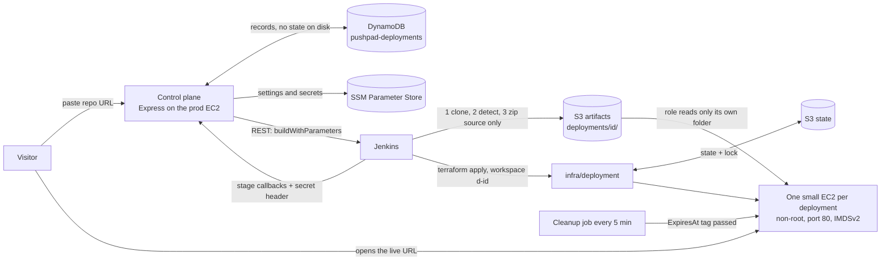

# PushPad

**Share your code as a live site in 2 minutes. No setup, no env vars.**

Paste a public GitHub repo, click Deploy, watch the pipeline run, and get a link that works for 30 minutes. Then the server is deleted. Think Vercel preview deployments, self-hosted on your own AWS with Jenkins and Terraform.

Tools: Git/GitHub, Jenkins, Terraform, AWS. No Docker, Kubernetes or Ansible. Region: ap-south-1.

PushPad does two jobs with the same pipeline ideas:

| Mode | What it does | Entry point |
|---|---|---|
| **Quick Share** (the product) | Deploys any visitor's public repo for 30 minutes | `Jenkinsfile.deploy`, `Jenkinsfile.destroy` |
| **Branch previews** (the original) | Every branch of PushPad's own repo gets a temporary EC2, `main` goes to prod with approval and rollback | `Jenkinsfile`, `Jenkinsfile.cleanup` |

## Architecture

The control plane is the existing Express app (`app/`). It serves the website and the API, and keeps all state in DynamoDB because prod instances are replaced on every deploy.

